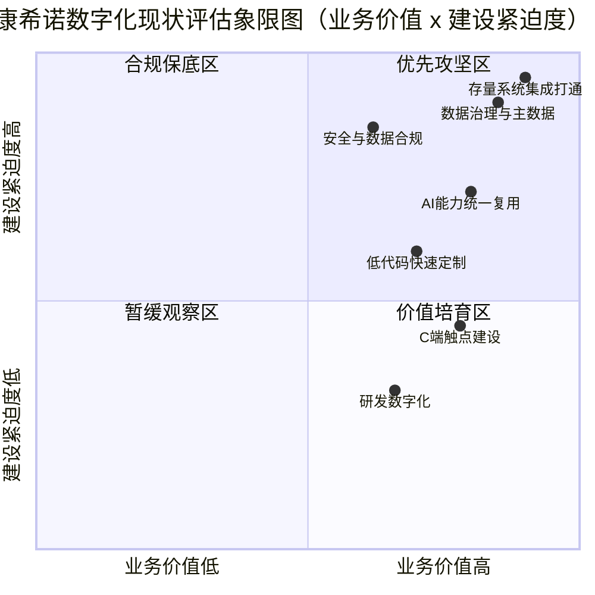

## 2. 现状盘点：哑铃状格局与四大矛盾

对管理层的含义：康希诺的数字化投入已在生产质量端形成可验证的合规能力，但投入结构明显偏科，市场端与研发端近乎空白，存量系统又缺少统一底座。本章回答三个问题：家底是什么、短板在哪里、与同行相比处于什么位置，为后续目标架构与实施路径提供事实基线。

### 2.1 企业基本面

康希诺生物股份公司2009年创立于天津经开区，主营创新疫苗研发、生产与商业化，A+H两地上市：2019年3月于港交所挂牌（6185.HK，港股第一疫苗股），2020年8月登陆科创板（688185.SH，科创板首支A+H疫苗股）【外部核实·现状核查§0】【外部核实·现状核查§5】。

| 维度 | 关键事实 | 标注 |
|---|---|---|
| 技术平台 | 五大技术平台：病毒载体疫苗、合成疫苗、蛋白结构设计与VLP组装、mRNA、制剂及给药 | 【外部核实·现状核查§5】 |
| 已上市产品 | 克威莎®（2021-02附条件上市、WHO EUL）、克威莎®雾优®（全球首款吸入式）、曼海欣®MCV4（2021-12获批，2026-02扩龄至3月龄–6周岁）、美奈喜®MCV2、优佩欣®PCV13i（2025-06获批）、盼康欣®DT3cP（2026-04获批，国内首个三组分百白破）、重组埃博拉疫苗（亚洲首个） | 【外部核实·现状核查§5】 |
| 产能基地 | 天津创新疫苗产业园近13万㎡、投资近100亿、年产能2.8亿剂；上海临港mRNA基地一期超10亿、1.7万㎡；2025-02 MCV4/PCV13i基地通过马来西亚PIC/S GMP认证 | 【外部核实·现状核查§4.6】 |
| FY2025财务 | 营收10.59亿元（+28.4%）、归母净利2,787万元（扭亏为盈）；2026Q1营收1.9亿元（+38.73%） | 【外部核实·现状核查§5】 |
| 收入结构 | 流脑系列9.68亿（+21.9%）、新冠0.23亿、肺炎0.21亿、技术转移及中间品0.17亿、CDMO 0.31亿 | 【外部核实·现状核查§5】 |
| 国际化 | MCV4印尼注册并于2025-09首发；巴基斯坦PCV13合作意向（2026-07）；沙特合作；向印尼Etana供应PCV13原液 | 【外部核实·现状核查§5】 |

点评：公司正处于多款新品放量、扭亏为盈的经营拐点，收入高度集中于流脑系列（约占九成）。商业化放量对供应链、质量合规与市场触达提出更高要求，数字化是承接这轮放量的基础设施。

### 2.2 数字化现状（外部事实核查）

以下事实经官网、交易所披露、政府及行业媒体交叉验证；未经内部访谈确认的部分以【待核实】标注。

| 领域 | 已核实事实 | 标注 |
|---|---|---|
| 生产与质量 | 官方口径已分阶段建设13套数字化系统并引入AI，覆盖「原材料采购→质量检验→生产执行→产品放行」全流程与全程追溯；AI用于生产数据与环境监测实时分析，质量管理从事后纠偏前移至事前预防。13套系统名单未公开披露 | 【外部核实·现状核查§4.1】；名单【待核实】 |
| 智慧仓储 | 中集创见WMS（2022年起），覆盖天津园区高架自动冷库与常温密集库，集成SAP（ERP）、英克OMS、嘉华赋码、冷库/密集库WCS、龙门设备系统六大系统；PDA扫码校验、批次/FIFO管控；天津冷藏配送中心1.3万㎡、可贮1.5亿支、年周转10亿支，物流调度效率提升近50% | 【外部核实·现状核查§4.2】 |
| 质量管理（QMS） | 2025-04启动Akso eGMP® QMS项目（FDA/EMA合规架构、全球多语言）；公司设有信息系统管理部 | 【外部核实·现状核查§4.4】 |
| 疫苗追溯 | 嘉华汇诚提供赋码/追溯系统，按《疫苗管理法》实现一物一码、物码同追，对接国家协同平台 | 【外部核实·现状核查§4.5】 |
| 数据仓库与BI | 2024-12与凯莱英临床（凯诺）启动DW+BI项目，定位AI可视化与市场洞察，支撑多产品多区域战略 | 【外部核实·现状核查§4.3】 |
| 协同与对外触点 | 中文官网与官方公众号为主要对外窗口；IR侧已采用上证路演中心网络互动业绩说明会（2026-05），官网股票信息直连东方财富；官网长期置顶防仿冒声明，仿冒官方账号问题客观存在 | 【外部核实·现状核查§1】【外部核实·现状核查§2】【外部核实·现状核查§5】 |
| C端触点 | 无自营C端预约平台：克威莎®预约依赖各省政府平台（粤健通/粤苗、随申办/健康云等），吸入式产品依赖上海健康云、北京声智健康等第三方渠道，曼海欣®无统一线上预约；未发现自营小程序 | 【外部核实·现状核查§2】【外部核实·现状核查§3】；小程序【待核实】 |
| 研发数字化 | 无公开披露，AI口径集中于生产质量与BI；未进入天津市先进级智能工厂名单（2025年两批、2026年第一批），无官方智能工厂认定 | 【外部核实·现状核查§4.7】 |

概括：生产、仓储、质量、合规追溯构成「实」的一端；C端、研发、权威认定构成「空」的一端，呈哑铃状分布。

### 2.3 内部痛点

以下痛点来自企业原草案的立项前盘点，属内部一手判断，本方案予以采信并作为需求基线：

| 痛点类别 | 具体表现 | 标注 |
|---|---|---|
| 存量系统多而散 | 存量30+业务系统（以ERP/MES/LIMS/WMS为主），各系统厂商、部署模式（本地/云）、数据库类型、接口能力与开放程度各异 | 【内部材料·原草案§2】 |
| 数据孤岛 | 数据相对割裂；主数据混乱，物料、供应商、客户存在多编码；历史报表取数难度大 | 【内部材料·原草案§2】 |
| 厂商锁定 | 业务变更依赖外部厂商，定制化成本高，紧急需求响应延期带来业务损耗 | 【内部材料·原草案§2】 |
| 运维成本高 | 年度厂商定制费、接口开发费、维保服务费叠加，整体运维成本高企 | 【内部材料·原草案§2】 |
| AI零散 | 零散AI项目无法复用，没有统一调用入口 | 【内部材料·原草案§2】 |

两点提示：其一，内部口径的「30+系统」与外部口径的「13套数字化系统」并不矛盾，前者为全公司IT资产总数，后者为生产质量端官方披露口径，两者之间的准确映射须以IT系统台账核实【待核实】。其二，外部核查可见SAP、OMS、WMS、QMS、追溯、数仓BI等多厂商系统并存，与「多厂商、接口碎片化」的内部判断相互印证。

### 2.4 成熟度评估

评估采用双标准组合：GB/T 39116-2020《智能制造能力成熟度模型》（五个等级，全国逾10万家企业贯标）与DB1501/T 0063-2024（生物制品专属，分规划级、规范级、集成级、优化级四级）【行业对标·对标库§五】。下表以DB1501/T 0063-2024四级口径做案头初评：

| 能力域 | 初评等级 | 主要依据 |
|---|---|---|
| 生产执行与过程控制 | ≈集成级 | 13套系统覆盖生产全流程，AI实时分析生产与环境数据【外部核实·现状核查§4.1】 |
| 仓储物流 | ≈集成级 | WMS集成六大系统，自动化冷库与批次管控落地【外部核实·现状核查§4.2】 |
| 追溯合规 | ≈集成级 | 一物一码、对接国家协同平台【外部核实·现状核查§4.5】 |
| 质量管理 | 规范级（向集成级过渡） | QMS于2025-04启动，尚在建设期【外部核实·现状核查§4.4】 |
| 数据与经营分析 | 规范级 | 数仓+BI于2024-12启动，应用深度待观察【外部核实·现状核查§4.3】 |
| 营销与C端服务 | 规划级 | C端触点接近于零【外部核实·现状核查§3】 |
| 研发数字化 | 规划级 | 无公开披露【外部核实·现状核查§4.7】 |
| 整体判断 | 规范级，哑铃状：生产质量端≈集成级，其余≈规划→规范级 | 综合上表 |

声明：本表为基于公开信息与内部盘点口径的案头初评，正式定级须按GB/T 39117-2020评估方法开展现场评估核实【行业对标·对标库§五】【待核实】。

### 2.5 行业对标位置

| 对标维度 | 标杆实践 | 康希诺相对位置 |
|---|---|---|
| 智能工厂认定 | 国药天坛蓉生获工信部2025年度卓越级智能工厂（血液制品首家），含8个AI场景、全流程电子批记录【行业对标·对标库§二】 | 已建13系统+AI，但未获官方智能工厂认定，处于「建成未认定」区间【外部核实·现状核查§4.7】 |
| 生产质量集成 | 北京科兴中维SAP+MES+SCADA+WMS+LIMS+LMS全链条集成（药监局典型案例）；北京民海生物采用西门子Opcenter Pharma MES，10万点采集、7000页电子批记录【行业对标·对标库§二】 | 覆盖广度相当，集成深度与电子批记录能力【待核实】 |
| QMS建设节奏 | SINOVAC科兴2018年启动集团信息化战略，2020年ERP+DMS上线，2022年MES/SCADA/LIMS/WMS全面上线【行业对标·对标库§三】 | QMS于2025-04启动，节奏晚于科兴约三年，但可直接对标其分期建设路线压缩工期【外部核实·现状核查§4.4】 |
| C端服务 | 约苗覆盖30省、6000+机构、4300万用户；粤苗以政府主导模式将建档从30分钟压缩至3分钟【行业对标·对标库§一】 | 空白，预约链路整体托管于政府与第三方平台【外部核实·现状核查§3】 |
| 国际先进水平 | GSK疫苗佐剂数字孪生，电子批记录人工复核从数百页降至20–30页；Sanofi Modulus无纸化模块化工厂，产品切换从数月缩至数天；Moderna以CodonBERT大模型使mRNA设计时间减少50%【行业对标·对标库§六】 | 代差明显；康希诺拥有mRNA技术平台，Moderna路径最具直接参照性【外部核实·现状核查§5】 |

判断：国内可比维度上，康希诺处于第二梯队靠前位置，生产质量端家底不弱，但缺权威认定背书；C端与研发两个维度落后标杆一个身位；国际维度存在代差，需以场景而非整厂对标的方式追赶。

### 2.6 四大矛盾归纳

基于2.1–2.5的证据，各建设方向的优先级定位如下图（横轴为业务价值，纵轴为建设紧迫度）：

> 源文件：docs/diagrams/03-现状评估象限图.mmd

综合全章证据，现状可归纳为四大矛盾：

1. 合规驱动强，市场驱动弱。已建成的数字化能力几乎全部指向GMP合规、质量管控与法定追溯（《疫苗管理法》基线），面向市场与接种者的数字化投入近乎为零（依据见2.2节）。
2. 生产质量端实，C端触点空。哑铃一端沉：生产质量端13系统+AI+WMS六系统集成；另一端空：预约链路托管于政府平台，无自营小程序与会员体系，品牌与接种者之间缺少自有数字通路（依据见2.2节）。
3. 存量系统多，统一底座无。30+系统多厂商并存，主数据多编码、取数难，缺少统一的集成与数据底座来承接打通、治理与复用（依据见2.3节）。
4. AI能力零散，复用入口缺。AI已点状应用于生产环境监测与BI可视化，但没有统一的能力封装与调用入口，无法跨场景复用，难以沉淀为企业资产（依据见2.2、2.3节）。

四大矛盾直接导出本方案的三条主线：强底座（解矛盾三）、补触点（解矛盾二）、提AI（解矛盾四），并以合规时间表为政策窗口（解矛盾一）。

### 2.7 待核实问题清单

本章以下关键事实未获公开信息确认，须在立项调研阶段逐项核实，访谈提纲见附录A：

1. 13套数字化系统的具体清单与建设厂商【待核实】（外部核查未披露，需索取IT系统台账）。
2. 内部「30+系统」台账口径：厂商、部署模式、数据库类型、接口能力、历史定制痛点【待核实】。
3. 自营微信小程序、视频号、抖音、小红书账号是否已建或在建【待核实】（外部核查未发现）。
4. 智能工厂/数字化车间官方认定情况【待核实】（外部核查未发现）。
5. 研发数字化（AI for R&D、数字孪生、研发段LIMS）现状【待核实】（无公开披露）。
6. C端预约/会员/健康管理平台的规划意愿与体制边界【待核实】（外部核查确认为空白）。
7. 数据安全与数据合规体系现状：等保定级、数据分级分类、跨境数据管理【待核实】（公开信息有限，仅见ISO 37301/37001与追溯合规）。
8. 2.4节成熟度初评等级，须按GB/T 39117-2020开展现场评估核实【待核实】。

## 附录A：待核实问题与访谈提纲

| 序号 | 待核实事项 | 为什么重要 | 建议访谈对象 | 拟提关键问题 |
|---|---|---|---|---|
| 1 | IT系统台账（30+系统清单、13套生产质量系统名单） | 目标架构的集成范围与系统沿用/替换决策，只能以台账为事实依据 | 信息系统管理部负责人 | 现有系统清单、厂商、合同期限、接口开放度、年度维保费用各是多少？哪些系统可开放API或数据库直连？ |
| 2 | 自营小程序、视频号等社媒资产 | 决定C端触点是从零建设还是盘活存量 | 品牌公关负责人、IR负责人 | 是否已注册自营小程序与视频号？更新频率与粉丝量级如何？处置仿冒账号有何经验？ |
| 3 | 智能工厂/数字化车间认定 | 关系政策资金申报与梯度培育（基础级→先进级→卓越级）路径 | 生产负责人、政府事务负责人 | 是否申报过天津市先进级智能工厂？未申报还是未入选？差距在哪些能力域？ |
| 4 | 研发数字化现状 | 研发是mRNA平台竞争力所在，而公开信息为零 | 研发负责人、IT负责人 | 研发段是否有LIMS、电子实验记录或试验数据管理？AI在抗原设计、工艺开发上有无探索？ |
| 5 | C端平台规划意愿与边界 | 疫苗流通体制决定C端打法：自建还是与政府平台合作 | 市场/商业化负责人、法务合规负责人 | 是否考虑自建患者教育或接种后随访平台？与政府预约平台的数据合作边界在哪里？ |
| 6 | 数据合规体系 | 涉及《数据安全法》《个人信息保护法》与健康医疗数据红线 | 信息安全负责人、法务合规负责人 | 等保定级覆盖哪些系统？数据分级分类是否完成？接种者数据有无出境场景？ |
| 7 | 成熟度现场评估 | 案头初评必须校准，避免目标设定失真 | 生产、质量、IT联合访谈 | 是否同意按GB/T 39116-2020与DB1501/T 0063-2024组合开展正式成熟度评估？ |
| 8 | AI项目清单与投入 | 判断AI复用底座应承接哪些存量能力 | IT负责人、生产与质量部门负责人 | 现有AI项目清单、投入与效果如何？哪些场景愿意迁移到统一AI能力平台？ |
