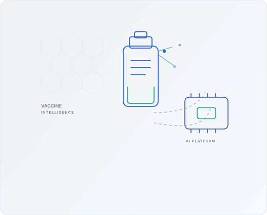
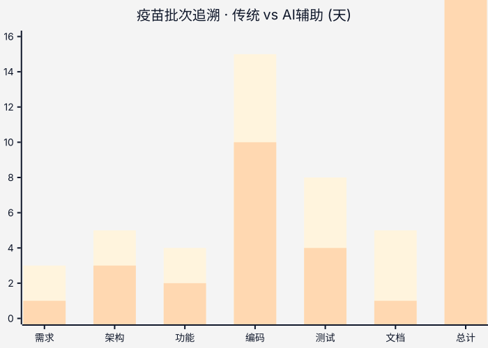
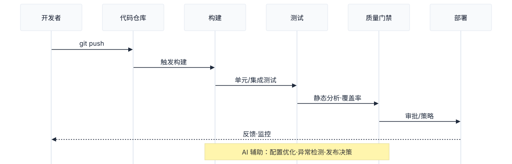
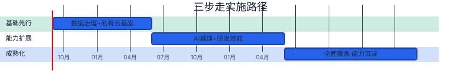

<!-- _class: lead -->

# 康希诺生物数字化落地方案

## AI驱动研发效能提升

**康希诺生物股份有限公司**

---

Agenda · <em>Vaccine Intelligence</em>

# 议程

| 序号 | 主题 | 重点 |
|:---:|------|------|
| 01 | 四大建设方向概览 | 全局视角 |
| 02 | **AI全面助力研发流程** | 核心重点 |
| 03 | 研发支撑体系 | CI/CD、质量、效能 |
| 04 | AI能力平台与场景 | 平台化能力建设 |
| 05 | 实施路径与保障 | 落地策略 |

> **本次重点**：AI如何贯穿软件开发生命周期，从需求到交付

---

Context · 01

# 背景与机遇

<b>行业趋势</b>生物医药数字化加速 · AI成为研发效率核心驱动 · 合规（GMP/数据安全法）倒逼基座升级

<b>康希诺机遇</b>多年信息化打底 · 核心系统已就绪 · 具备向深水区迈进的条件

- 数字化不再是“可选”，而是疫苗研发与合规的**必答题**

---

Where we are · <em>Systems Ready</em>

# 现状与起点

| 系统 | 覆盖环节 | 状态 |
|------|----------|------|
| SAP | ERP、财务、供应链 | ✅ 已运行 |
| MES | 生产执行 | ✅ 已运行 |
| LIMS | 实验室管理 | ✅ 已运行 |
| WMS | 仓储物流 | ✅ 已运行 |
| QMS | 质量管理 | ✅ 已运行 |

<b>⬡ 数据治理</b>主数据统一 · 数据贯通

<b>⬢ AI复用</b>从项目制到平台制

<b>⬣ 基座统一</b>私有云 · 合规底座

<b>✦ 研发效能</b>ELN · 流程数字化

---

Data & BI · 痛点

# 数据治理+BI：痛点

<b>⬡ 主数据不统一</b>编码规则不一致 · 跨系统对账依赖人工

<b>◐ 取数周期长</b>数据分散 · 时效性差 · 决策滞后

<b>⬢ 质量难追溯</b>无统一度量 · 问题难定位根因

<b>✦ 决策靠经验</b>“事后报表”而非“实时洞察”

---

Data & BI · 方案

# 数据治理+BI：方案

| 模块 | 内容 | 效果 |
|------|------|------|
| **主数据统一** | 物料、人员、设备、客户统一编码 | 一致性 |
| **数据汇聚** | 打通SAP/MES/LIMS/WMS数据链路 | 自动贯通 |
| **指标中心** | 统一经营指标体系 | 多维洞察 |
| **经营看板** | 可视化分析看板 | 实时呈现 |

> 3 项 核心转变：贯通 · 可追溯 · 实时洞察

---

AI Infra · 平台化

# AI基建概览

痛点 AI项目各自独立 · 模型/数据/接口无法跨场景复用 → 方案 · 统一AI能力平台

| 能力 | 说明 | 复用 |
|------|------|------|
| 文档解析OCR | 实验报告、合同等文档自动解析 | 高 |
| 图像质检 | 产品外观检测、缺陷识别 | 高 |
| 时序预测 | 产能预测、库存预测 | 中 |
| 流程自动化RPA | 重复性流程自动执行 | 中 |
| 大模型网关 | 兼容本地私有化与第三方API | 关键 |

> 一次建设 · 多处复用 <small>业务系统快速接入</small>

---

Private Cloud · 合规底座

# 私有云基座

| 模块 | 内容 | 合规 |
|------|------|------|
| **容器化** | 统一资源编排与调度 | 弹性 |
| **网络安全** | 访问控制、入侵检测 | 等保 |
| **数据加密** | 分级分类，敏感数据加密 | 数据安全法 |
| **灾备恢复** | 数据备份与灾难恢复 | 连续性 |
| **审计堡垒机** | 统一操作审计 | GMP CSV |

核心价值 为数据治理 · AI基建 · 业务系统提供统一运行底座

---

Architecture · 目标总览

# 目标架构总览

> 协同层 → 业务系统群 → 能力层（数据+AI）→ 私有云基座 → 配套体系 · 横幅线框（1340×126）

---

R&D Efficiency · 痛点

# 研发效能管理（1/2）：痛点

<b>⬡ 数据分散</b>实验数据难检索 · 难复用

<b>◐ 进度不透明</b>项目/资源无统一视图

<b>⬢ 申报分散</b>文档管理 · 流程靠人工

<b>✦ 知识流失</b>人员流动带来资产流失

> 4 类痛点制约研发知识资产沉淀

---

R&D Efficiency · 方案

# 研发效能管理（2/2）：建设内容

| 模块 | 功能 | 价值 |
|------|------|------|
| **电子实验记录本** | 结构化存储、模板化记录、数据检索 | 复用 |
| **研发项目管理** | 项目组合、资源分配、进度跟踪 | 透明 |
| **注册申报** | 文档统一管理、流程跟踪 | 规范 |
| **知识管理** | 工艺参数、实验数据、技术文档沉淀 | 沉淀 |

效果 实验可检索 · 项目可视化 · 申报标准化 · 知识资产化

---

<!-- _class: lead -->

# AI全面助力研发流程

## 从需求到交付，AI贯穿全流程

---

AI Dev Lifecycle · 全景

# AI研发全景图

> 6 阶段 <small>蓝框=核心编码 · 绿框=知识沉淀 · 线框风格统一</small>

---

Stage 01 · 需求梳理

# 需求梳理阶段

Before · 痛点

- 需求模糊、歧义多，反复沟通确认
- 用户故事编写耗时
- 验收标准不清晰
- 竞品分析依赖人工

After · AI赋能

- **AI需求澄清**：模糊描述→结构化需求
- **AI用户故事**：自动生成用户故事、验收标准
- **AI竞品分析**：自动收集和分析竞品信息

> 50%+ <small>周期缩短</small> · 模糊需求一键结构化

---

Stage 02 · 蓝图/架构

# 蓝图/架构设计

Before · 痛点

- 架构方案依赖个人经验
- 技术选型缺乏系统评估
- 技术风险识别不全面
- 方案对比文档编写耗时

After · AI赋能

- **AI架构方案**：生成多种架构方案
- **AI技术选型**：分析各技术栈优劣
- **AI风险识别**：识别潜在技术风险
- **AI方案对比**：自动生成对比矩阵

> 40%+ <small>周期缩短</small> · 方案生成与风险前置

---

Stage 03 · 功能设计

# 功能设计

Before · 痛点

- PRD编写耗时，细节容易遗漏
- 接口设计依赖人工，联调问题多
- 数据模型设计反复迭代

After · AI赋能

- **AI PRD生成**：自动生成PRD初稿
- **AI接口设计**：自动生成API契约
- **AI数据模型**：生成数据模型建议

> 45%+ <small>周期缩短</small> · 契约与模型一次成型

---

Stage 04a · 编码生成

# 编码实现：代码生成

Before · 痛点

- 大量重复性代码编写
- 新技术学习曲线陡峭
- 代码风格不一致
- 开发者疲于写代码

After · AI赋能

- **AI代码生成**：根据需求生成代码框架
- **AI代码补全**：上下文感知的智能补全
- **AI代码解释**：快速理解遗留代码
- **AI代码翻译**：跨语言代码转换

> 30%+ <small>编码效率提升</small> · 从写代码到审代码

---

Stage 04b · 代码质量

# 编码实现：代码质量

Before · 痛点

- 代码审查依赖人工，效率低
- 技术债积累，难以量化管理
- 安全漏洞发现滞后
- 代码规范执行不一致

After · AI赋能

- **AI代码审查**：自动识别问题、规范违规
- **AI重构建议**：识别代码坏味道
- **AI技术债识别**：量化技术债，优先级排序
- **AI安全扫描**：识别潜在安全漏洞

> 60%+ <small>审查效率提升</small> · 规范与安全左移

---

Stage 05 · 测试验证

# 测试验证

Before · 痛点

- 测试用例编写耗时，覆盖率不足
- 自动化测试脚本维护成本高
- 缺陷根因分析依赖经验
- 回归测试范围选择困难

After · AI赋能

- **AI测试用例**：自动生成测试用例
- **AI自动化测试**：自动生成测试脚本
- **AI缺陷分析**：分析缺陷模式，识别根因
- **AI回归测试**：智能选择回归范围

> 50%+ <small>用例编写提效</small> · 覆盖率与回归更智能

---

Stage 06 · 文档交付

# 文档与交付

Before · 痛点

- 文档编写滞后，与代码不同步
- API文档维护成本高
- 知识散落在个人笔记中
- 变更日志容易遗漏

After · AI赋能

- **AI API文档**：基于代码自动生成
- **AI用户手册**：基于功能描述生成
- **AI变更日志**：自动生成版本变更
- **AI知识沉淀**：自动提取和整理知识

> 70%+ <small>文档提效</small> · 代码与知识同频沉淀

---

<!-- _class: compact -->

Case · 疫苗批次追溯（1/2）

# 端到端案例：效率对比

**场景：疫苗批次追溯 — 40天 → 21天** ↓ 47%

> 蓝=传统 · 深蓝=AI辅助 · 绿=关键提升点 · 横幅显示

---

<!-- _class: compact -->

Case · 疫苗批次追溯（2/2）

# 端到端案例：分阶段数据

| 阶段 | 传统 | AI辅助 | 提升 |
|------|------|--------|------|
| 需求梳理 | 3天 | 1天 | 66% |
| 架构设计 | 5天 | 3天 | 40% |
| 功能设计 | 4天 | 2天 | 50% |
| 编码实现 | 15天 | 10天 | 33% |
| 测试验证 | 8天 | 4天 | 50% |
| 文档交付 | 5天 | 1天 | 80% |
| **总计** | **40天** | **21天** | 47% |

---

Value · 放大器而非替代者

# AI研发价值总结

<b>30-70%</b>效率提升

<b style="color: var(--cansino-mint)">显著 ↑</b>质量改善

<b>持续</b>知识沉淀

| 价值维度 | 具体效果 |
|----------|----------|
| **效率提升** | 需求、架构、编码、测试、文档 |
| **质量改善** | 代码规范 · 测试覆盖 · 安全左移 |
| **知识沉淀** | 最佳实践沉淀 · 新人上手加快 |

> AI是放大器 团队判断力仍是根基

---

R&D Support · CI/CD

# CI/CD流水线

| 模块 | 内容 | 价值 |
|------|------|------|
| **自动化构建** | 代码提交自动触发构建 | 快速反馈 |
| **自动化测试** | 单元测试、集成测试自动执行 | 质量保障 |
| **自动化部署** | 一键部署到各环境 | 效率提升 |
| **流水线管控** | 质量门禁、审批流程、发布策略 | 风险控制 |

---

Quality · 内建质量

# 代码质量管控

| 维度 | 内容 | 指标 |
|------|------|------|
| **静态分析** | 代码规范、复杂度、重复率 | 违规率 |
| **质量门禁** | 构建失败条件、合并前检查 | 通过率 |
| **技术债管理** | 量化跟踪、优先级排序 | 技术债指数 |
| **代码评审** | 标准化评审流程、AI辅助评审 | 覆盖率 |

> 质量是内建的 <small>不是测试出来的</small>

---

Metrics · 度量改进

# 研发效能度量

| 指标 | 定义 | 目标 |
|------|------|------|
| **需求吞吐量** | 单位时间交付需求数 | 提升 |
| **交付周期** | 从需求提出到上线的时间 | 缩短 |
| **缺陷率** | 千行代码缺陷数 | 降低 |
| **代码覆盖率** | 测试覆盖的代码比例 | 提升 |
| **变更失败率** | 部署后回滚或修复的比例 | 降低 |

> 原则 度量是为了**改进**，不是为了**考核**

---

DevOps · 一体化

# DevOps实践

| 模块 | 内容 | 关注 |
|------|------|------|
| **环境管理** | 开发、测试、预发、生产标准化 | 一致性 |
| **配置管理** | 配置与代码分离 | 可追溯 |
| **监控告警** | 应用性能监控、异常告警 | 可观测 |
| **发布策略** | 蓝绿 · 金丝雀 · 灰度 | 低风险 |

与AI结合 异常检测 · 容量预测 · 日志分析

---

<!-- _class: compact -->

Platform · 一次建设 多处复用

# AI能力平台架构

分层解耦 业务层 → AI能力层 → 网关层 → 基座层（绿底合规）· 横幅 653×69

---

Use Cases · 全价值链

# AI应用场景矩阵

| 环节 | 应用场景 | AI能力 | 价值 |
|------|----------|--------|------|
|  **研发** | 方案筛选、工艺优化、文献分析 | ML、NLP | 周期缩短 |
|  **生产** | 预测性维护、过程优化、智能检测 | 时序预测、图像识别 | 良率提升 |
|  **供应链** | 需求预测、库存优化、物流调度 | 预测模型、优化算法 | 成本降低 |
|  **销售** | 销售预测、客户洞察、内容生成 | 预测模型、NLP | 精准营销 |
|  **支撑** | 财务分析、合规监控、知识管理 | 异常检测、NLP | 效率提升 |

> 一次建设 · 多处复用 · 线框图标统一描边 1.5px

---

<!-- _class: compact -->

Value Chain · 建设→能力→效果

# 业务价值链路

> 建设方向 → 能力提升 → 业务效果 · 横幅 385×69 · 闭环传导

---

Landing · 技术+组织

# AI落地关键要素

| 要素 | 说明 | 常见误区 |
|------|------|----------|
| **数据准备** | 数据质量是AI效果的基础 | 工具即得 |
| **模型选型** | 场景驱动的模型选择与调优 | 追新 |
| **安全合规** | 数据安全、模型安全、GMP合规 | 忽视合规 |
| **团队能力** | AI理解力、应用能力、判断能力 | 过度依赖 |

> 关键提醒 AI落地是**技术+组织**的双重变革

---

Roadmap · 分步推进

# 三步走实施路径

| 阶段 | 目标 |
|------|------|
| **基础先行** | 6-12月 · 统一主数据 · 打通数据链路 |
| **能力扩展** | 12-24月 · 建设AI能力平台 |
| **成熟化** | 24-36月 · 规模化推广 · 沉淀资产 |

> 分步推进 降低风险 · 快速见效

---

Team · 工具 vs 根基

# 团队能力建设

<b>AI不能完全依赖</b>生成内容需人工校验 · 业务决策需专家把关 · 质量安全需人工兜底

<b>核心理念</b>AI是工具 · 团队能力是<b>根基</b>

| 能力层次 | 内容 | 重点 |
|----------|------|------|
| **工具使用** | AI工具的基本操作和最佳实践 | 必备 |
| **输出判断** | AI输出的校验、筛选和优化 | 关键 |
| **业务结合** | AI与业务场景的深度融合 | 核心 |
| **战略决策** | AI应用的优先级和资源分配 | 高阶 |

---

Risk · 提前应对

# 风险与应对

| 风险类型 | 具体风险 | 应对策略 |
|----------|----------|----------|
| **技术风险** | AI效果不达预期 | 小试点 · 快迭代 |
| **组织风险** | 团队接受度低 | 培训先行 |
| **合规风险** | 数据安全、GMP合规 | 合规审查 |
| **供应商风险** | 技术锁定 | 多供应商 |

> 原则 识别风险 · 提前应对 · 分步验证

---

Outcome · 核心资产

# 预期效果

<b>30-70%</b>效率提升

<b>↓ 成本</b>IT成本优化

<b style="color: var(--cansino-mint)">沉淀</b>数据与AI资产

<b>实时</b>决策支撑

| 价值维度 | 具体效果 |
|----------|----------|
| **业务效率** | 跨系统数据贯通 · AI辅助研发 |
| **IT成本** | 系统整合 · 运维复杂度降低 |
| **能力沉淀** | 主数据统一 · AI平台制 · 知识沉淀 |
| **决策支撑** | “事后报表” → “实时洞察” |

> 长期价值 数字化能力成为企业**核心资产**

---

Next Steps · 从研发效能切入

# 下一步行动

1

启动诊断

1-2周

2

试点选择

2-4周

3

基础建设

3-6月

4

AI试点

6-12月

5

规模推广

12月+

| 阶段 | 行动 |
|------|------|
| **启动诊断** | 现状评估，明确优先级 |
| **试点选择** | 1-2个高价值场景 |
| **基础建设** | 数据治理 + 私有云基座 |
| **AI试点** | AI能力平台 + 研发效能 |
| **规模推广** | 全面推广，持续优化 |

---

<!-- _class: lead -->

# 谢谢

## 康希诺生物数字化落地方案

**AI驱动研发效能提升**
